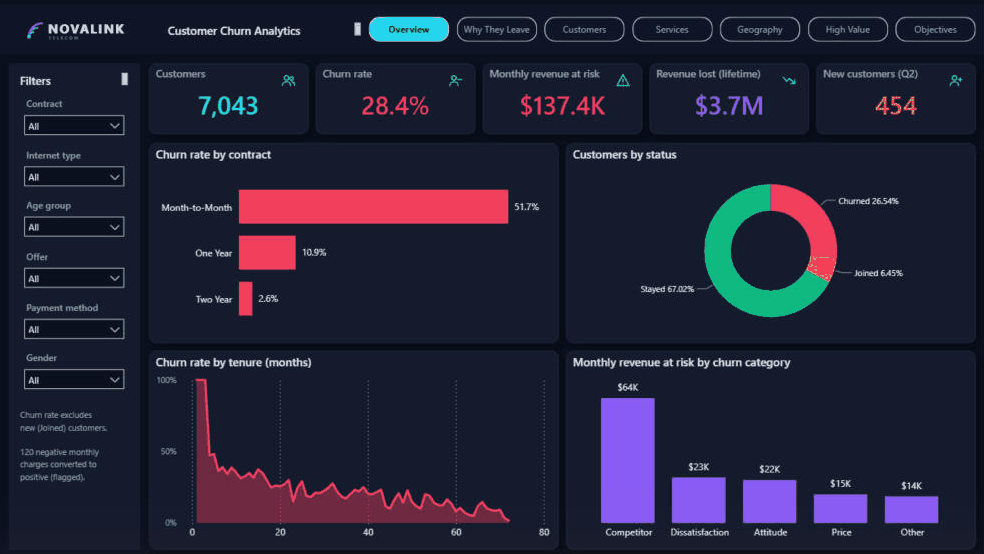
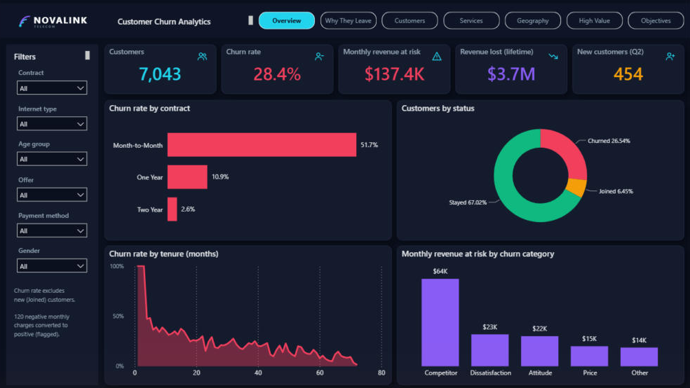
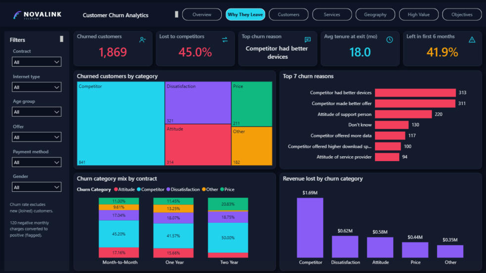
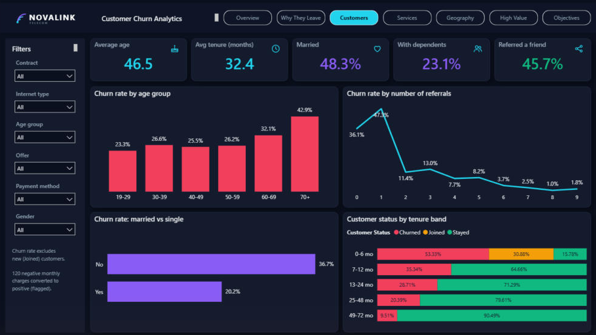
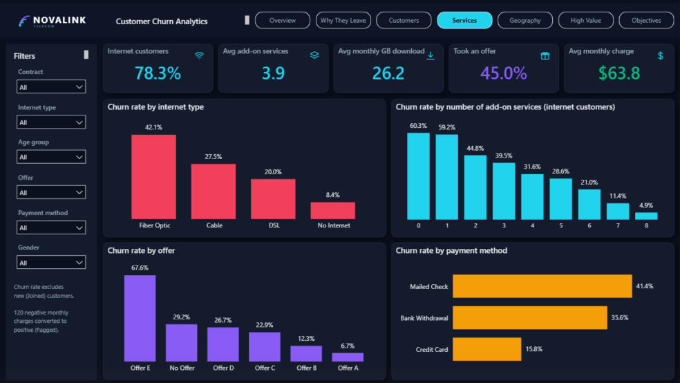
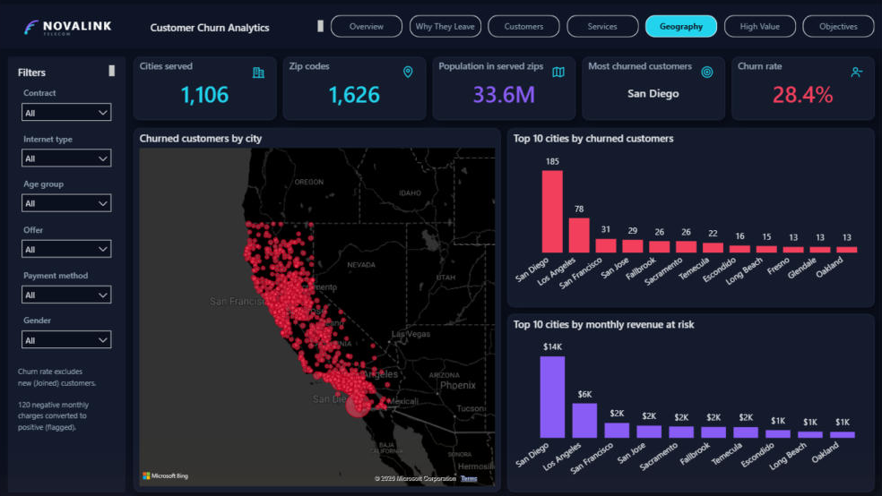
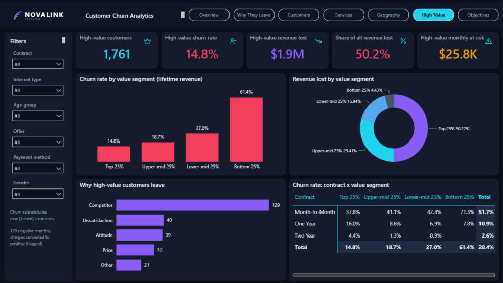
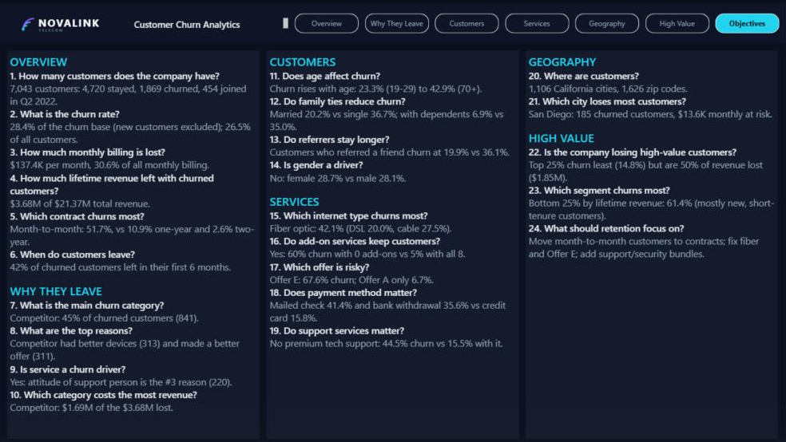

# 📡 Telecom Customer Churn — Power BI Dashboard

**NOVALINK Telecom** (fictional brand) · Power BI · Power Query · DAX · Dark-mode report



## Business problem
A California telecom operator is losing customers. Management wants to know **how many customers leave, why they leave, who is most at risk and how much revenue is lost**, and whether the company is losing its **high-value customers**. The report answers 24 business questions for Q2 2022.

## Data
| Table | Rows × Cols | Content |
|---|---|---|
| telecom_customer_churn.csv | 7,043 × 38 | one row per customer: demographics, location, services, contract, charges, revenue, status (Stayed / Churned / Joined), churn category and reason |
| telecom_zipcode_population.csv | 1,671 × 2 | estimated population per California zip code |

Source: Maven Analytics Data Playground (*Telecom Customer Churn*, **License: Public Domain**), via Kaggle [`shilongzhuang/telecom-customer-churn-by-maven-analytics`](https://www.kaggle.com/datasets/shilongzhuang/telecom-customer-churn-by-maven-analytics). Fictional company data.

## Data issues found and how they were handled
1. **Structural blanks, not errors:** 1,526 customers without internet have every internet column blank; 682 without phone service have phone columns blank. → labelled `No Internet` / `No Phone` (numeric columns kept blank so averages stay correct).
2. **`Offer` uses the text "None"** (not a blank) for 3,877 customers → labelled `No Offer`. Found during review: the "took an offer" KPI showed 100% until this was fixed (correct value 45.0%).
3. **Churn category / reason blank for customers who did not churn** → `Not Churned`.
4. **120 customers have a negative Monthly Charge** (min −$10). → converted to positive and flagged in `Charge Was Negative`. *Assumption:* treated as a sign error. With a real client these rows would be confirmed with the business first, because they could also be refunds or credits.
5. **Revenue check:** `Total Revenue = Total Charges − Total Refunds + Extra Data + Long Distance` holds for every row (difference 0.00).
6. **New customers (Joined, tenure 1–3 months) are excluded from the churn rate**, since they could not have churned yet: churn rate = 28.4% (26.5% if they were counted).

## Power Query cleaning (10 rules) — see `power-query/`
1. Data types set with en-US culture
2. Structural blanks → `No Internet` / `No Phone` / `No Offer`
3. Churn category / reason blank → `Not Churned`
4. Negative monthly charge → positive + flag
5. Flags: `Is Churned`, `In Churn Base`
6. Bands: age group, tenure band, monthly charge band (with sort-order columns)
7. `Add-on Services` = number of the 8 optional services the customer has
8. `Value Segment` = quartile of lifetime revenue (Top 25% … Bottom 25%)
9. Location columns moved to a `Locations` dimension (zip, city, average lat/long, population)
10. Final data types set as the last step

## Model
`Customers` (fact, 7,043 rows) → `Locations` (1,626 zip codes, joined with population). A separate `Metrics` table holds **41 DAX measures** (`dax/measures.dax`): churn rate, retention, revenue lost, monthly revenue at risk, competitor share, early-churn share, high-value churn, offer uptake and more.

## Report pages
| Page | Content |
|---|---|
| 1 · Overview | KPIs, churn rate by contract, customer status, churn rate by tenure month, monthly revenue at risk by churn category |
| 2 · Why They Leave | churn categories (treemap), top 7 reasons, category mix by contract, revenue lost by category |
| 3 · Customers | churn by age group, by number of referrals, married vs single, status by tenure band |
| 4 · Services | churn by internet type, by number of add-on services, by offer, by payment method |
| 5 · Geography | map of churned customers by city, top cities by churned customers and by revenue at risk |
| 6 · High Value | churn and revenue lost by value segment, why high-value customers leave, contract × segment matrix |
| 7 · Objectives | the 24 business questions with answers |

Six filters on every page (contract, internet type, age group, offer, payment method, gender); each filter works on its own page.

## Key insights
- **28.4%** of customers churned in the quarter; the company loses **$137.4K of monthly billing** (30.6%) and **$3.68M** of lifetime revenue left with them.
- **Contract is the strongest driver:** month-to-month churn **51.7%** vs 10.9% one-year and **2.6%** two-year.
- **The first 6 months are critical:** 42% of churned customers left within 6 months.
- **Competitors win 45%** of churned customers, mainly with **better devices** (313) and **better offers** (311); support-staff attitude is the #3 reason.
- **Fiber optic churns 42.1%** (DSL 20.0%); customers with **no add-on services churn 60%** vs **5%** with all 8.
- **Offer E** customers churn **67.6%**; Offer A only 6.7%.
- **High-value customers (top 25%) churn the least (14.8%) but represent 50.2% of the revenue lost ($1.85M).**
- Family ties and referrals reduce churn: with dependents 6.9% vs 35.0%; referrers 19.9% vs 36.1%.

## Screenshots








## Repository
```
dashboard/     NOVALINK.pbix (Power BI report)
data/          raw data (zip) + cleaned data (zip)
power-query/   M code for Customers and Locations
dax/           all 41 DAX measures
images/        screenshots + GIF
```
To open: unzip the raw data into a folder, open `dashboard/NOVALINK.pbix` in Power BI Desktop, set the `RawFolder` parameter in Power Query to that folder and refresh.

---
**Ahmed Saad** — Data Analyst · [GitHub](https://github.com/AhmedSaad-DataAnalyst)
